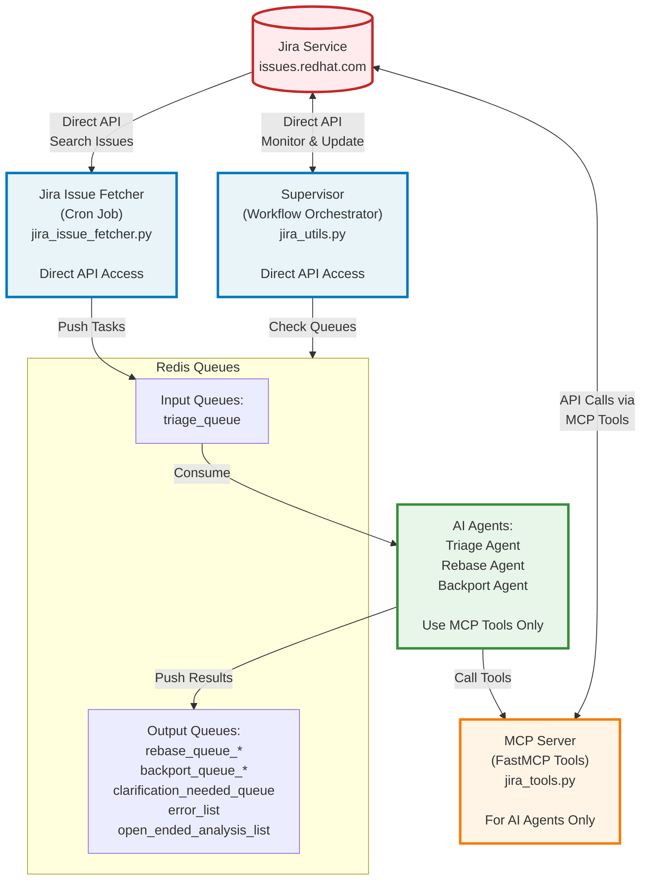
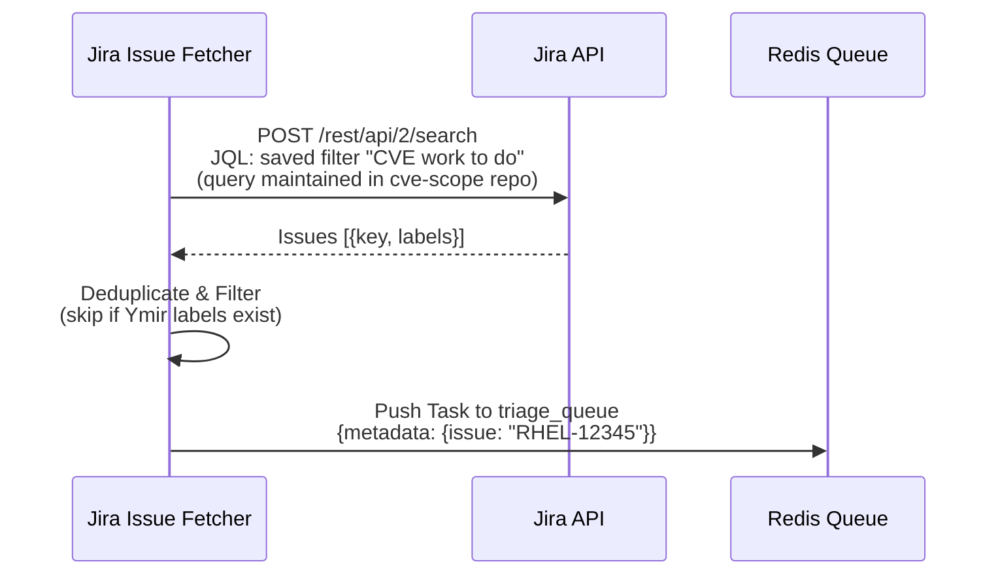
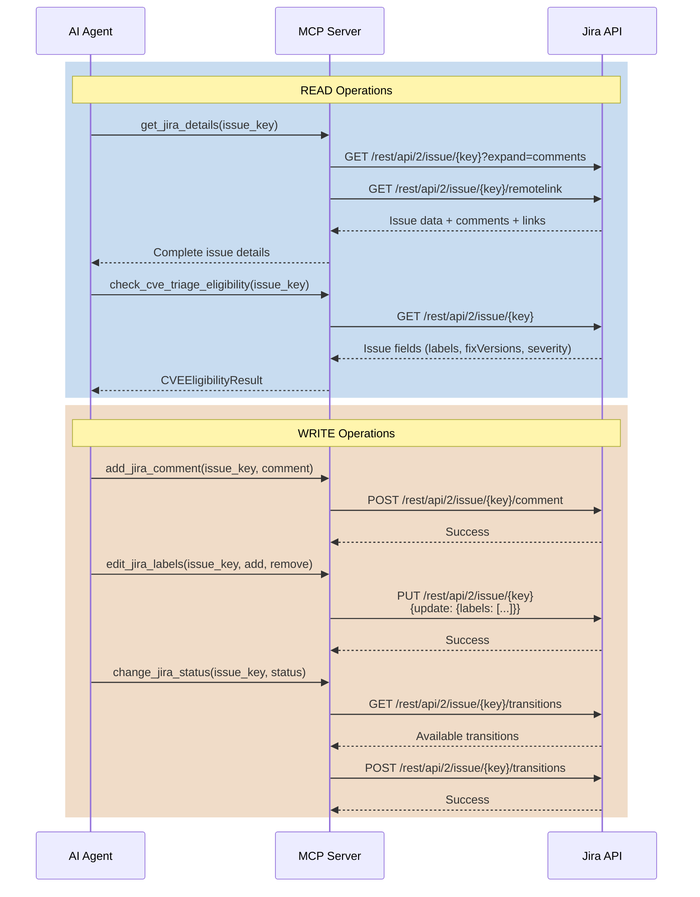
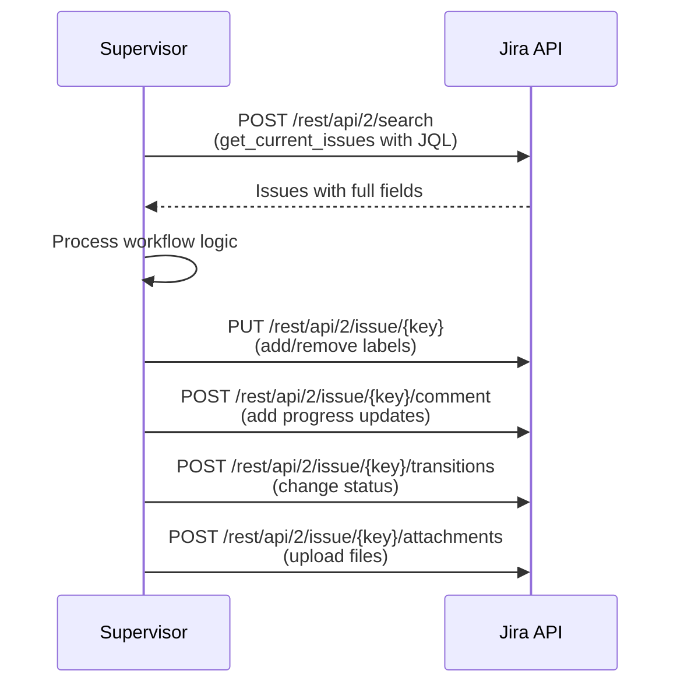
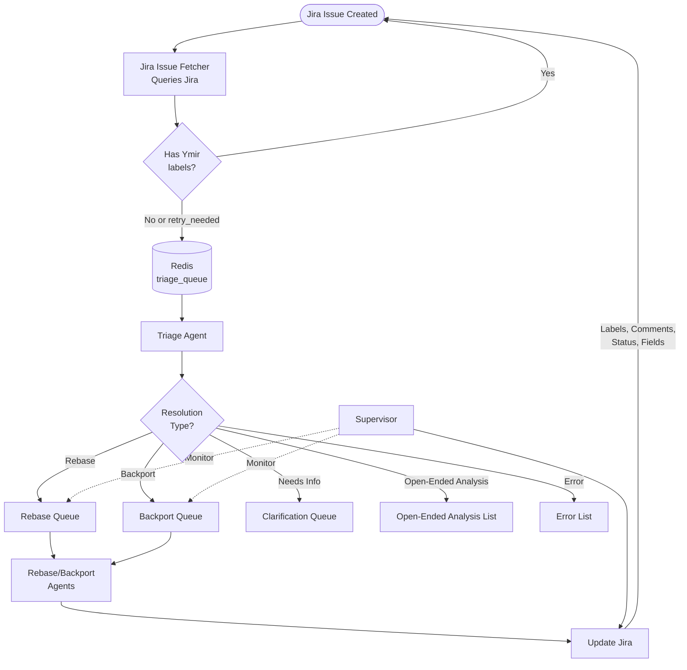

# Jira Data Flow Chart

This document describes the data flow between the AI Workflows system and Jira service.

## System Architecture



**Key Distinctions:**
- **AI Agents** - Use MCP Server tools to access Jira indirectly
- **Python Services** - Direct HTTP API calls to Jira using requests library
- **MCP Server** - Provides controlled FastMCP tools for AI agents only

## Component Types

### AI Agents (Use MCP Server)

These are AI-powered agents that use the MCP Server tools to interact with Jira:
- **Triage Agent** - Analyzes issues, determines resolution type (rebase/backport/clarification/open-ended-analysis)
- **MultiStreamTriageAgent** - Shares CVE/package investigation across RHEL trackers, then invokes the existing per-issue checks with the worker's `DRY_RUN` setting
- **Rebase Agent** - Updates packages to new upstream versions
- **Backport Agent** - Applies specific patches to packages

*These agents access Jira ONLY through MCP tools like `get_jira_details()`, `add_jira_comment()`, etc.*

CVE extraction from summary text lives in `ymir/common/cve.py`. Agents import
this shared parser directly so parsing does not load the privileged Jira client
or its `MOCK_JIRA` implementation and `flexmock` dependency.

### Python Services (Direct Jira API Access)

Traditional Python services that make direct HTTP calls to Jira:
- **Jira Issue Fetcher** - Two CronJobs querying Jira on a schedule and pushing matches to the Redis triage queue: a main sweep against a saved Jira filter (query maintained in the separate [`cve-scope`](https://gitlab.cee.redhat.com/jotnar-project/cve-scope) repo) and a `ymir_todo`-label sweep. Uses `requests` library for direct API calls.
- **Multi-stream fetcher** - A separate one-shot entry point, `ymir.jira_issue_fetcher.multistream_triage_fetcher`, selects trackers with `MULTISTREAM_TRIAGE_QUERY` and groups them before enqueueing. It has no scheduled deployment and accepts live or dry-run configuration.
- **Supervisor** - Workflow orchestration service that monitors issues/errata, advances them through testing/release process. Makes direct API calls using `requests` library via functions like `jira_api_get()`, `jira_api_post()`, `jira_api_put()`.

*These services do NOT use the MCP Server - they call Jira API directly.*

### MCP Server

FastMCP server that provides controlled tools for AI agents:
- Exposes 7 Jira-related tools (see MCP Server Tool Summary below)
- Uses `aiohttp` for async HTTP calls to Jira
- Only used by AI agents, not by Python services

## Data Flow Overview

### 1. Jira Issue Fetcher → Jira (READ)



**Key Features:**
- Pagination: 500 issues/page
- Rate limiting: 5 calls/second
- Exponential backoff on failures
- Deduplication across all Redis queues

### Multi-stream CVE intake

The multi-stream path groups Jira trackers by **one CVE ID and downstream
package**, across fix versions. It leaves the normal fetcher's routing and
manual triggers unchanged. See [README-agents.md](README-agents.md#multi-stream-triage-runs)
for commands.

1. The fetcher reads all pages matching `MULTISTREAM_TRIAGE_QUERY`, requesting summary,
   downstream component and fix versions, then groups the matches. It includes
   singleton groups and does not discover siblings outside the query.
2. It logs and skips non-CVEs, multi-CVE trackers, invalid or modular components,
   and trackers without exactly one named fix version. It does not send skipped
   trackers to the normal queue.
3. On `--enqueue`, it writes `MultiStreamTriageTask` JSON to
   `multistream_triage_queue`. Preview mode prints tasks without opening a
   Redis connection. The shared schema in `ymir/common/multistream_triage.py` does not
   import the agent runtime, so the existing fetcher image can run this module.
4. The worker moves one task to `multistream_triage_processing`, loads Jira
   details and eligibility through MCP, and computes `is_older_zstream` using the
   same current-stream classification as individual triage. Only trackers with
   `eligibility=immediately` participate in shared discovery; per-issue code
   handles the other trackers' eligibility outcomes.
5. `MultiStreamTriageAgent` returns a separate preliminary recommendation for each
   eligible tracker. The worker validates coverage and rechecks Jira inputs before
   calling the existing per-issue workflow. Changed summary, description,
   comments, component or fix version rejects that tracker's handoff. A tracker
   failure does not prevent processing the remaining trackers. Shared-analysis
   failures are recorded without falling back to individual discovery.
6. The worker records analysis, per-issue outcomes and errors in
   `multistream_triage_results` and removes the processing entry in one Redis
   transaction. An interrupted run can leave a processing entry for inspection;
   automatic recovery is not implemented.

The fetcher uses WATCH/MULTI across these three lists to prevent duplicate
enqueueing by concurrent fetchers. A queued or processing task blocks another
task for that CVE/package. Recorded attempts, including failures, suppress their
tracker keys; a later query can enqueue new siblings after the active task
finishes. Retain results for deduplication. Retry/invalidation policy and a
replacement for scanning the growing results list remain prerequisites for
production use. Invalid stored task data stops enqueueing rather than bypassing
deduplication. The manual `enqueue` command does not perform these fetcher checks.

#### Package selection with JQL

For a package-based rollout, use complementary queries: wrap the whole original
selection in parentheses, then add `AND component in (curl, openssl)` for the
multi-stream selection and `AND component not in (curl, openssl)` for the normal
selection. Preserve the existing ownership, status and embargo restrictions,
including parentheses around any `ymir_todo` alternatives. Handle empty component
values explicitly if they belong in the normal selection.

The multi-stream worker accepts live runs (`DRY_RUN=false`, the default) and
dry runs (`DRY_RUN=true`). Shared discovery stays read-only; per-issue Jira writes
follow the existing workflow and gateway controls. The worker still records
results without running the normal queue worker's terminal-label lifecycle,
downstream dispatch or reproducer enqueueing.

The current multi-stream fetcher is not a production intake replacement.
It does not inspect normal queues or implement employee-author
checks for `ymir_todo`, priority, issue locks, stale-label recovery or queue-depth
throttling. Before switching a package's live routing, define how to handle
unsupported trackers and manual/API triggers, and drain its existing queued and
in-flight work. JQL exclusion alone does not prevent those other entry points
from processing the same tracker.

#### Traces and comparison

The agent spans use `MultiStreamTriageAgent` under a
`MultiStreamTriageWorkflow` root span. Each tracker also
has a `TriageWorkflow` span inside the grouped trace. Count that trace once when
comparing groups with standalone individual traces, rather than counting its
nested workflows as independent control runs.

Compare outcome agreement and group-level totals for LLM calls, discovery and
applicability calls, prompt tokens, clones, tool calls, errors and elapsed time.
Report per-tracker cost separately. Match model and configuration for controlled
comparisons; historical traces from another model provide a structural comparison
only. Larger prompts and downstream checks can offset the saved discovery work.

### 2. MCP Server Tools → Jira (READ/WRITE)



For an exactly Important or Critical Y-stream CVE, `CVEEligibilityResult` also
contains shipped clones from each RHEL major's configured current Z-stream that
have a non-empty Fixed in Build value. `upcoming_z_streams` and older Z-stream
clones are ignored for inheritance. Each source retains its Jira key, NVR, and
fixVersions. This metadata travels in `Task.metadata` to the backport queue,
which uses only the single source matching the target Y-stream major. Old tasks
without the field remain valid and use the normal backport path. A shipped clone
without an NVR still
satisfies the existing dependency decision but cannot be inherited.

### 3. Supervisor → Jira (READ/WRITE)



## Complete Workflow



## MCP Server Tool Summary

| Tool | Method | Endpoint | Purpose |
|------|--------|----------|---------|
| **get_jira_details** | GET | `/rest/api/2/issue/{key}` | Fetch issue details, comments, remote links |
| **check_cve_triage_eligibility** | GET | `/rest/api/2/issue/{key}` | Analyze CVE eligibility for triage |
| **verify_issue_author** | GET | `/rest/api/2/user` | Check if author is Red Hat employee |
| **set_jira_fields** | PUT | `/rest/api/2/issue/{key}` | Update fixVersions, severity, target_end |
| **add_jira_comment** | POST | `/rest/api/2/issue/{key}/comment` | Add public/private comment |
| **change_jira_status** | POST | `/rest/api/2/issue/{key}/transitions` | Transition issue status |
| **edit_jira_labels** | PUT | `/rest/api/2/issue/{key}` | Add/remove labels |

## Authentication & Configuration

All components authenticate using:
- **Bearer Token**: `JIRA_TOKEN` environment variable
- **Base URL**: `JIRA_URL` (default: https://issues.redhat.com)
- **Headers**:
  ```json
  {
    "Authorization": "Bearer {JIRA_TOKEN}",
    "Content-Type": "application/json",
    "Accept": "application/json"
  }
  ```

---

**Last Updated:** 2026-03-03
